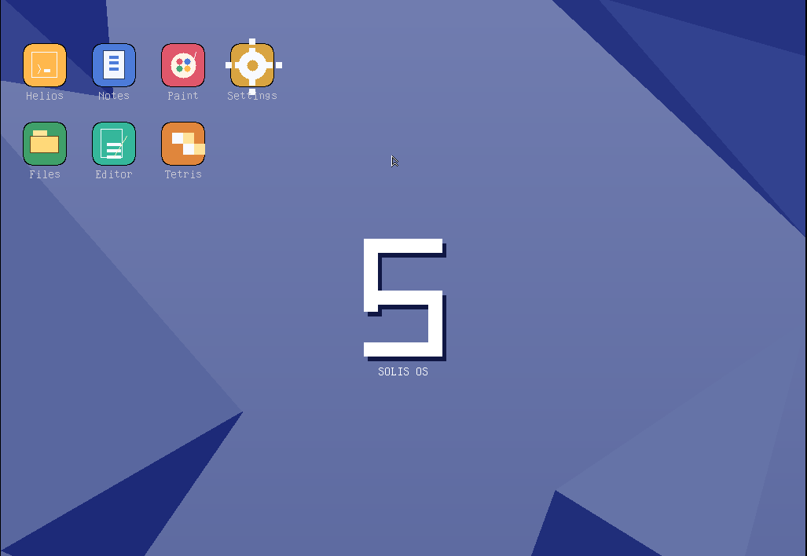
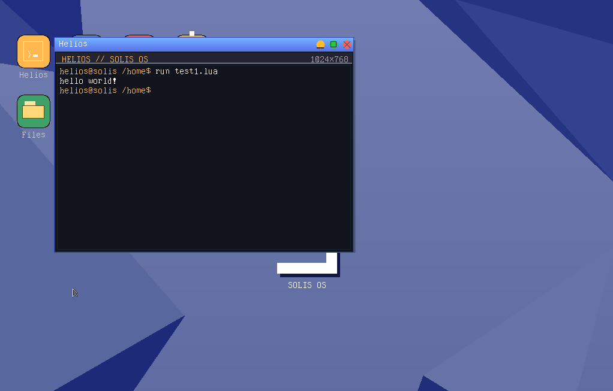

# Solis OS

Solis is a 64-bit hobby operating system for x86-64. It boots with GRUB
(Multiboot2), draws a GUI desktop through a VBE framebuffer, and ships a small
set of built-in applications. It is written in freestanding C with no libc, and
is primarily developed and run inside QEMU.

## Why the name Solis?

Solis is inspired by the Latin word for "sun." I liked the image of the sun
shining over Rome: a steady source of light, energy, and possibility. That
connection is a bit of personal mythology for the project, not a claim that
Solis is a historical Roman name. For me, it gives the OS a bright, forward-
looking identity while nodding to the old world.

## Philosophy

Solis is built as a hands-on exploration of how an operating system works,
from booting and hardware drivers to the desktop and applications. Its goal is
to be approachable, self-contained, and fun to shape: a place to experiment,
learn, and make a computing environment feel personal.

Unix and Linux have deep histories, mature ecosystems, and design ideas that
have influenced operating systems everywhere, including this project. Solis
isn't trying to replace them or claim to be a better Unix. The difference is
mostly one of purpose and scale: Solis is a small hobby OS developed as a
cohesive project, where I can build and understand each layer myself, rather
than a general-purpose system intended to support the breadth of hardware,
software, users, and workflows that Linux and Unix-like systems serve.

## About the creator

I'm Luis, the creator of Solis. I've been obsessed with technology since I was
little, always curious about how computers work and what you can make with
them. Solis brings that curiosity into one long-running project: building an
operating system from the ground up, learning by doing, and turning ideas into
something I can boot, explore, and keep improving.

## Stability status

Solis is **partially stable**. It boots reliably and the desktop, apps, and
filesystem work in everyday use, but it is a hobby OS that has **not been
tested to its full extent**:

- An experimental host-side installer can install Solis onto an existing GPT
  disk layout. It is limited to the legacy primary-master ATA storage hardware
  supported by the kernel and has not been validated across real machines.
- It has not been validated on a wide range of real hardware.
- Expect occasional bugs and rough edges.

## Features

- **Boot**: GRUB 2 / Multiboot2, BIOS and UEFI boot media, 1024x768x32 VBE framebuffer
- **GUI**: Desktop, window manager, app-specific drawn icons, floating taskbar
  with pinned launchers and a system tray, and an app grid
- **Redraw engine**: Entity-based GUI rendering that treats desktop elements,
  windows, taskbar, mouse, and other GUI components separately and redraws
  only the entities that have changed
- **Themes**: Voxel Dusk, BoredOS, Aurora, Gnome, Sunset, Cherry Blossom,
  Starfield, and solid colors
- **Apps**: Helios, Notepad, Paint, Settings, Files, Task Manager, SOLPKG,
  Editor, Tetris, Solis Blocks
- **Languages**: A built-in C source interpreter and C/Lua syntax highlighting
  in Editor
- **Filesystem**: SOLFS on an ATA (IDE) disk or GPT Solis data partition, with
  bounded allocation chains and mount-time consistency checks, plus a small VFS
- **Installation**: host-side helper for an existing GPT layout; it preserves
  other partitions but updates boot code and formats the selected SOLFS partition
- **Networking**: RTL8139 driver with ARP, ping, DNS, and HTTP client support
- **Input**: PS/2 keyboard + mouse, and an I2C touchpad driver
- **Time**: CMOS real-time clock driver with a selectable timezone and a
  syscall API usable by applications (see below)

## Screenshots

### Solis OS desktop



### Helios terminal


### Lua execution



## Applications

Solis ships with ten built-in apps. They are compiled as freestanding
binaries, wrapped in the SPX package format, and embedded in the kernel. They
can be launched from the desktop icons, the taskbar's pinned launchers, or the
Apps grid (the launcher button on the left of the taskbar):

| App | What it does |
|--------------|---------------------------------------------------------------------|
| **Helios** | Interactive shell with filesystem commands and a C source runner |
| **Notepad** | Plain-text editor with save/load |
| **Paint** | Pixel drawing canvas with a palette and brush tools |
| **Settings** | Theme/wallpaper, background color, and timezone configuration |
| **Files** | Browse the SOLFS disk |
| **Task Manager** | Live CPU load graph and process list |
| **SOLPKG** | Package manager for the SOLPKG repo |
| **Editor** | Source code editor with C syntax highlighting (Ctrl+S save, Ctrl+N new) |
| **Tetris** | Classic falling-blocks game |
| **Solis Blocks** | First-person 3D voxel sandbox with mining and block building |

## Using the desktop

- Click a **desktop icon**, a **taskbar** launcher, or open the **Apps grid**
  to launch an app. Windows can be dragged by their title bar.
- Each window has **minimize**, **maximize**, and **close** buttons (top
  right) that stay flat until hovered; windows cast a soft drop shadow.
- The **taskbar** is a floating rounded card at the bottom: the launcher on
  the left, pinned app launchers plus a button per open window in the middle
  (a dot marks apps that are running), and the tray with RAM, date, and a
  live clock on the right. Click a window button to focus, minimize, or
  restore it; pinned launchers shrink automatically when many windows are
  open.
- The **Settings** app changes the theme and background in real time.
- **Settings > Time & Date** changes the clock timezone and saves it for the next boot.
- Helios supports `cc file.c` for syntax checking and `run file.c` for
  interpreting C source. Lua execution is not currently available.

## Minimum system requirements

Solis is a lightweight 64-bit OS, but it still expects a specific hardware
environment. These are the minimums to run it (the defaults used by the
`make run` QEMU setup):

- **CPU**: 64-bit x86-64 with long-mode support; one core is enough
- **RAM**: 256 MB
- **Graphics**: VBE-capable display adapter able to provide a
  1024x768x32 framebuffer mode
- **Storage**: a 512-byte-sector ATA/IDE disk exposed as the primary master;
  AHCI/NVMe and other disks are not supported by the current kernel driver
- **Input**: a PS/2 keyboard and PS/2 mouse (I2C touchpad is optional)
- **Network** *(optional)*: an RTL8139 Ethernet card for networking
- **Boot**: GRUB 2 with Multiboot2 support

The recommended way to run Solis today is inside QEMU (see
[Running](#running)) — no installer is required there.

## x86-64 architecture status

GRUB's Multiboot2 entry still begins in 32-bit protected mode; the boot stub
enables paging and long mode before entering the 64-bit kernel. Kernel and
application pointers and executable code use the x86-64 ABI. The early page
tables identity-map the first 512 GiB of physical address space, and ACPI
discovery prefers 64-bit XSDT/FADT addresses with legacy RSDT fallback.

The kernel now has a Multiboot memory-map-based physical page allocator and
4 KiB virtual mapping/protection primitives. Kernel text is read-only, and
read-only data and writable data sections are non-executable when the CPU
supports NX. The current virtual-memory manager operates on one shared kernel
address space; Solis does not yet have per-process address spaces, user mode,
or kernel/user isolation. Physical memory above the 512 GiB boot identity map
is not directly accessible or allocatable.

The 64-bit GDT includes a TSS with a dedicated ring-0 stack and independent
IST stacks for double faults, NMIs, and machine checks. Unused IDT vectors are
left absent, and CPU exceptions report the faulting instruction and, for page
faults, CR2 and access details before halting. The boot stub checks for long
mode and PAE before entering 64-bit mode. This improves kernel fault handling,
but does not yet provide a user-mode execution or process-isolation boundary.

## Requirements (for building)

The build targets x86-64 (`-m64`) and needs the usual OS-dev toolchain. On
Fedora, install the following (VirtualBox is optional, only for `make vbox-disk`):

```sh
sudo dnf install -y \
  gcc make \
  qemu-system-x86 grub2-tools grub2-efi-x64-modules gdisk efibootmgr \
  xorriso mtools
```

Other distros: an x86-64 GCC/binutils toolchain + `qemu-system-x86_64` +
BIOS and EFI GRUB modules + `xorriso` + `mtools` (Debian/Ubuntu packages:
`grub-pc-bin grub-efi-amd64-bin`).

On Debian/Ubuntu, Fedora, Arch, or openSUSE, run `make get` from a Linux
terminal to install the build and run dependencies. The prompt is
case-insensitive. On Windows, first use WSL and run the command inside the
Linux distribution.
### Windows

The kernel must be linked as ELF x86-64 (`ld -m elf_x86_64`). MSYS2 UCRT64 and
MinGW GCC produce Windows PE/COFF objects, so they can compile individual
files but cannot link this kernel. Use WSL for the complete build:

```powershell
wsl --install -d Ubuntu
```

Inside Ubuntu/WSL:

```sh
sudo apt update
sudo apt install build-essential binutils grub-pc-bin grub-efi-amd64-bin \
  gdisk efibootmgr xorriso mtools qemu-system-x86 python3
cd /mnt/d/MyOS
make
```

An `x86_64-elf-gcc` cross-toolchain is also suitable. MSYS2 may still be used
for editing, but its UCRT64 linker is not suitable for the kernel link step.

## Building

```sh
make            # builds build/solis.iso and the package-disk SPX files
make build/disk.img  # also build the SOLFS disk image (built automatically by make run)

make clean      # removes build artifacts
```

The x86-64 kernel and applications are compiled into a single ISO, and the ten
built-in apps are embedded in the kernel as x86-64 SPX packages.

## Running

Run in QEMU (default VGA):

```sh
make run
```

Other targets:

```sh
make run-serial      # logs kernel serial output to serial.log
make run-nographic   # headless (serial console)
make run-dbg         # serial to stdio with a user-mode NIC
make vbox-disk       # convert build/disk.img to build/solis.vdi for VirtualBox
```

The default QEMU invocation boots the ISO with the pre-loaded package disk
attached as an IDE drive. Networking uses QEMU's user-mode NIC with an RTL8139
model (`-nic user,model=rtl8139`).

## Installing to a physical disk

`make` produces a hybrid BIOS/UEFI boot ISO when both GRUB platform modules are
installed. The experimental host-side installer supports only a disk prepared
in advance with a GPT partition table and these three unmounted partitions:

1. A FAT32 EFI System Partition of at least 64 MiB, with no existing `/boot`
   or `EFI/Solis` directory.
2. A dedicated BIOS boot partition of at least 1 MiB (GPT type `EF02`).
3. A SOLFS data partition of at least 4 MiB with type GUID
   `7A5D9E13-45B4-4C2A-8C74-534F4C495346`.

The installer does not create or resize partitions. It writes GRUB boot code
to the selected disk, reserves the BIOS boot partition for GRUB, adds a UEFI
boot entry, places Solis boot files in the ESP's `/boot` directory, and
overwrites the first 4 MiB of only the selected SOLFS partition. Other
partitions and unrelated ESP files are left untouched. Secure Boot is not
supported.

Run the host installer from Linux booted in UEFI mode. First review its
validation-only output, then explicitly confirm the disk before applying:

```sh
make
sudo bash tools/install-solis.sh --disk /dev/sdX --esp /dev/sdX1 \
  --bios-boot /dev/sdX2 --solfs /dev/sdX3
sudo bash tools/install-solis.sh --disk /dev/sdX --esp /dev/sdX1 \
  --bios-boot /dev/sdX2 --solfs /dev/sdX3 --apply
```

Replace every example device with the correct devices on your machine. The
`--apply` run requires typing `INSTALL SOLIS ON <disk-name>`; it changes the
disk's BIOS boot code and UEFI boot order and formats the selected data
partition. Do not run it against a disk containing partitions you have not
backed up.

Important hardware limitation: the installed kernel currently detects only
the primary-master legacy ATA/IDE device. A successful bootloader installation
does not make AHCI, NVMe, USB, or secondary ATA storage usable by Solis. Test
the ISO and installed boot path in a VM before relying on a physical install.

## Clock & timezones

Solis reads the date/time from the CMOS real-time clock and treats it as UTC,
then applies the selected timezone offset. The current time is shown live in
the taskbar tray. To change the timezone:

1. Open **Settings** (desktop icon, taskbar launcher, or the Apps grid).
2. Go to the **Time & Date** tab.
3. Click a timezone (e.g. *Chicago*, *New York*, *London*, *Tokyo*).

The selection applies immediately to the whole system. It is kept in memory,
so it resets to UTC on reboot.

### RTC API

The time API is exposed to applications through the syscall table (see
`include/solis/syscall.h`). Kernel side lives in `kernel/rtc.c` and apps reach
it through the wrappers in `apps/glue.c`.

```c
#include <solis/rtc.h>

struct rtc_time t;

rtc_get_time(&t);                 /* fills t with local time + date        */
rtc_set_timezone(3);              /* switch to Chicago (UTC-6)             */
int  tz = rtc_get_timezone();     /* index of the active timezone          */
int  n  = rtc_get_timezone_count();
rtc_get_timezone_name(i, buf, n); /* copy a timezone's name into buf       */
int  off = rtc_get_timezone_offset(i); /* minutes east of UTC for zone i   */
```

`struct rtc_time` fields: `second`, `minute`, `hour`, `day`, `month`, `year`,
`weekday` (0 = Sunday .. 6 = Saturday), `tz_offset` (minutes east of UTC) and
`tz_index` (selected timezone index). Timezone offsets are fixed; daylight
saving is not applied.

## Project layout

```text
boot/             Multiboot2 entry (32-bit transition to long mode) + GRUB config
kernel/           core kernel: console, gdt/idt/pic, keyboard/mouse, RTC,
                  graphics (VBE), timer (PIT), ATA, SOLFS/VFS, SPX package
                  loader, PCI + RTL8139 networking, x86-64 interrupt entry
gui/              desktop shell (windows, taskbar, app grid, login)
window_manager/   thin facade over the GUI
desktop/          desktop init/redraw
apps/             built-in SPX applications + syscall glue
pkg/              packaged apps (taskmanager, solpkg) and the SOLPKG repo
                  metadata
tools/            SPX/SOLFS build helpers, host installer, and test HTTP server
include/solis/    public headers shared by the kernel and applications
```

## License

[Apache 2.0](LICENSE)
