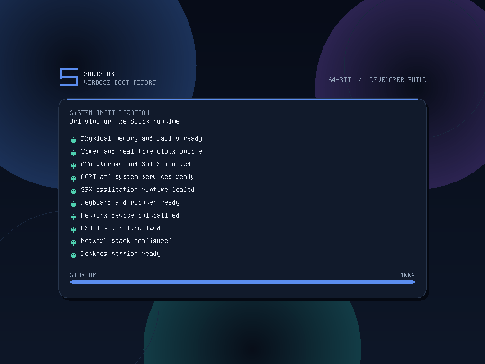
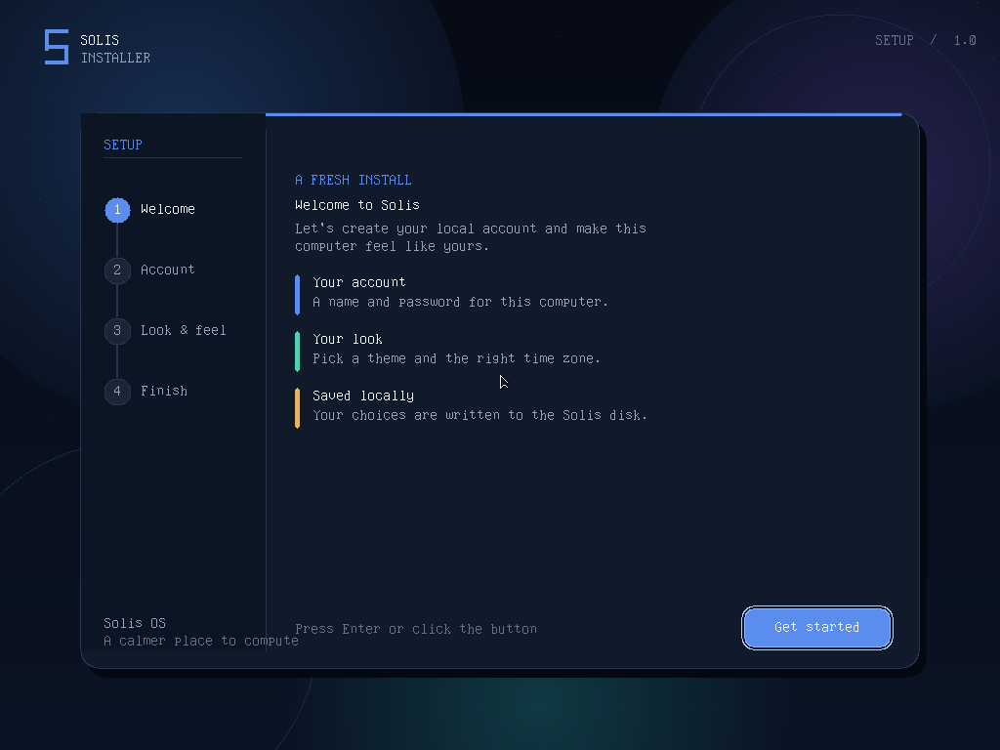
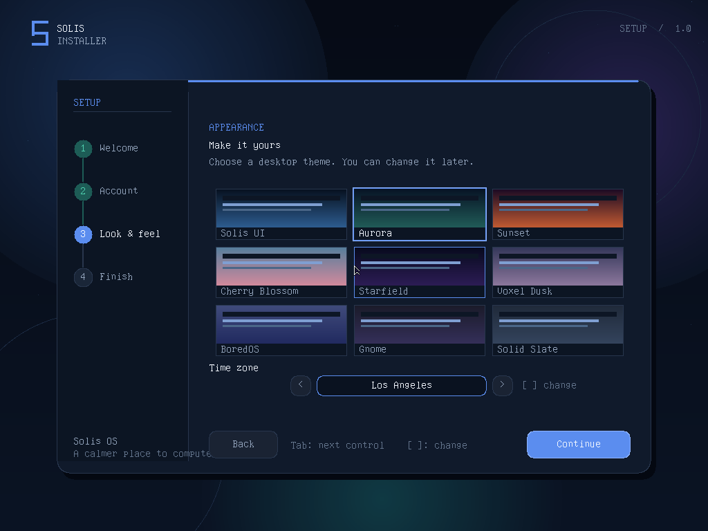
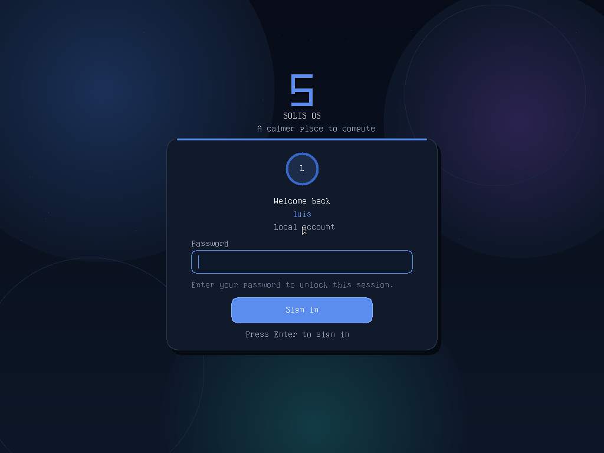
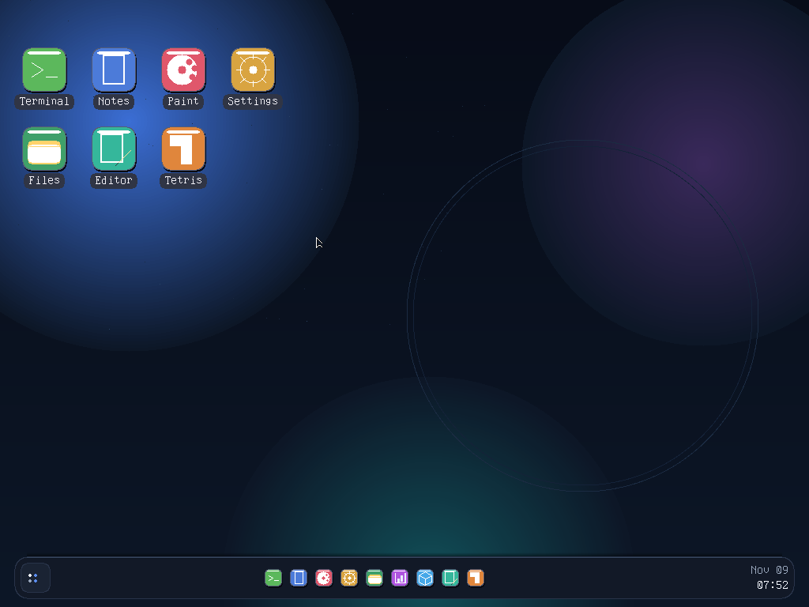
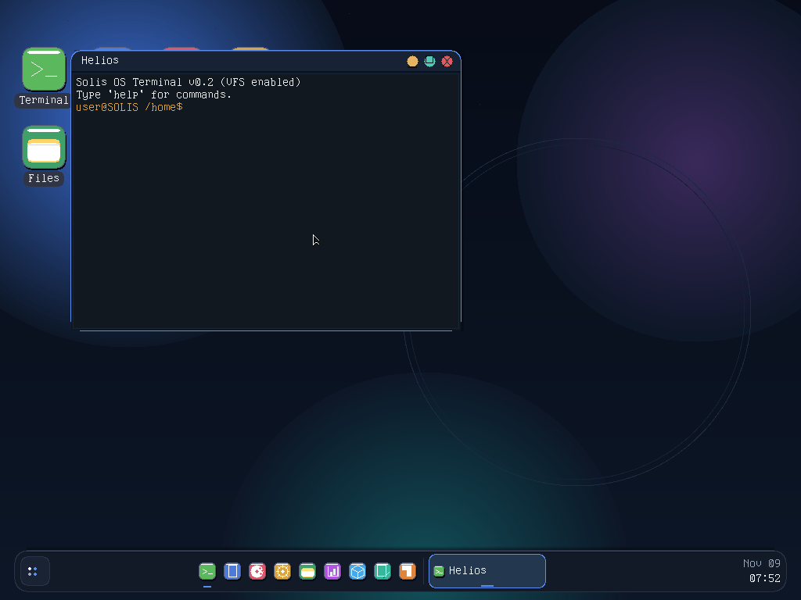
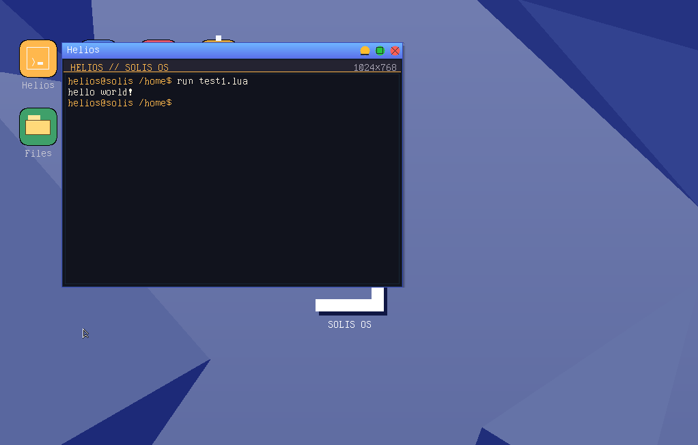

# Solis OS

Solis is a 64-bit hobby operating system for x86-64. It boots with GRUB
(Multiboot2), draws a GUI desktop through a VBE framebuffer, and ships a small
set of built-in applications. **Solis 2.0 "Daybreak"** adds a required edition
step with three install profiles, passwordless guest sessions, and a real
playable Doom port in the Extra edition. It is written in freestanding C with
no libc, and is primarily developed and run inside QEMU.

## Why the name Solis?

Solis is inspired by the Latin word for "sun." I liked the image of the sun
shining over Rome: a steady source of light, energy, and possibility. That
connection is a bit of personal mythology for the project, not a claim that
Solis is a historical Roman name. For me, it gives the OS a bright, forward-
looking identity while nodding to the old world.

## Philosophy

Solis is built as a hands-on exploration of how an operating system works,
from booting and hardware drivers to the desktop and applications. Its goal is
to be approachable, self-contained, and fun to shape: a place to experiment,
learn, and make a computing environment feel personal.

Unix and Linux have deep histories, mature ecosystems, and design ideas that
have influenced operating systems everywhere, including this project. Solis
isn't trying to replace them or claim to be a better Unix. The difference is
mostly one of purpose and scale: Solis is a small hobby OS developed as a
cohesive project, where I can build and understand each layer myself, rather
than a general-purpose system intended to support the breadth of hardware,
software, users, and workflows that Linux and Unix-like systems serve.

## About the creator

I'm Luis, the creator of Solis. I've been obsessed with technology since I was
little, always curious about how computers work and what you can make with
them. Solis brings that curiosity into one long-running project: building an
operating system from the ground up, learning by doing, and turning ideas into
something I can boot, explore, and keep improving.

## Stability status

Solis is **partially stable**. It boots reliably and the desktop, apps, and
filesystem work in everyday use, but it is a hobby OS that has **not been
tested to its full extent**:

- The in-OS first-boot **Solis Setup** requires an edition choice (**Minimal**,
  **Standard**, or **Extra**, with Extra preselected), then creates a local
  account with a salted password hash or a passwordless **guest** account,
  plus the theme and timezone. It can format a blank raw/VDI disk, or a
  dedicated GPT Solis partition, during first install; it never rewrites an
  unrelated MBR/GPT layout.
- An experimental host-side installer can install Solis onto an existing GPT
  disk layout. It is limited to the ATA/IDE and AHCI/SATA storage hardware
  supported by the kernel and has not been validated across real machines.
- It has not been validated on a wide range of real hardware.
- Expect occasional bugs and rough edges.

## Features

- **Boot**: GRUB 2 / Multiboot2, BIOS and UEFI boot media, 1024x768x32 VBE
  framebuffer, and a verbose framebuffer boot report before setup or login
- **GUI**: Solis UI Engine desktop, window manager, app-specific drawn icons,
  a dark abstract wallpaper, rounded windows and taskbar, and an app grid
- **Redraw engine**: Entity-based GUI rendering that treats desktop elements,
  windows, taskbar, mouse, and other GUI components separately and redraws
  only the entities that have changed
- **Themes**: Solis UI Engine (calm navy abstract wallpaper, blue/cyan
  accents, and flat rounded chrome), Voxel Dusk, BoredOS, Aurora, Gnome,
  Sunset, Cherry Blossom, Starfield, and solid colors
- **Editions**: Minimal keeps the core apps, Standard adds every built-in app,
  and Extra adds a real Doom shareware port. Apps outside the selected edition
  are pruned at install time and their staged package files are removed.
- **Guest access**: **Continue as guest** is available in setup and on the
  sign-in screen. Guest sessions are persisted locally, need no password, and
  are marked **GUEST** in the desktop menu and tray.
- **Apps**: Helios, Notepad, Paint, Settings, Files, Task Manager, SOLPKG,
  Editor, Tetris, Solis Blocks, Calculator, Doom (Extra only)
- **Recent polish**: single-instance windows, edge snapping, double-click
  maximize, Ctrl+W/Ctrl+Q, keyboard app-menu navigation, persistent themes,
  Paint drawing tools and undo, Tetris hold, calculator memory, sortable
  Files, pauseable Task Manager, Notepad/Editor status and navigation, a
  Settings gateway ping, Helios command history, and a Blocks compass
- **Languages**: A native x86-64 C subset compiler, an `SCX` executable-image
  runner, and an integer-only Lua interpreter in Helios, plus C/Lua syntax
  highlighting in Editor
- **Filesystem**: SOLFS on an ATA/IDE or AHCI/SATA disk, or a GPT Solis data
  partition, with bounded allocation chains and mount-time consistency checks,
  plus a small VFS
- **Setup**: full-screen first-boot installer with a required edition step,
  local or guest account, theme, and timezone; it formats a blank disk when
  needed, stores the account as a salted hash, and the sign-in screen enforces it
- **Installation**: host-side helper for an existing GPT layout and a
  self-booting UEFI VDI builder; the host helper preserves other partitions
  while updating boot code and formatting the selected SOLFS partition
- **Networking**: RTL8139 wired Ethernet driver with DHCP, ARP, ping, DNS, and
  an experimental HTTP client; Wi-Fi and HTTPS are not yet supported. Settings
  shows current network availability and the Wi-Fi support status.
- **Input**: PS/2 keyboard + mouse and xHCI USB boot-protocol HID keyboards
  and mice; selected Intel and AMD SMBus controller support; HID-over-I2C
  touchpads remain experimental. USB input is QEMU-tested but still needs
  validation on physical hardware.
- **Time**: CMOS real-time clock driver with a selectable timezone and a
  syscall API usable by applications (see below)

## Screenshots

### Verbose boot report



### Solis Setup





### Sign-in



### Solis OS desktop



### Helios terminal



### Lua execution



## Applications

Solis ships with twelve built-in apps. They are compiled as freestanding
binaries, wrapped in the SPX package format, and embedded in the kernel. They
can be launched from the desktop icons, the taskbar's pinned launchers, or the
Apps grid (the launcher button on the left of the taskbar):

| App | What it does |
|--------------|---------------------------------------------------------------------|
| **Helios** | Interactive shell with filesystem commands, a native C compiler, `SCX` runner, and Lua interpreter |
| **Notepad** | Plain-text editor with save/load |
| **Paint** | Pixel drawing canvas with a palette and brush tools |
| **Settings** | Theme/wallpaper, background color, and timezone configuration |
| **Files** | Browse the SOLFS disk |
| **Task Manager** | System summary: CPU, RAM, uptime, hardware ID, and installed apps |
| **SOLPKG** | Package manager for the SOLPKG repo |
| **Editor** | Source code editor with C syntax highlighting (Ctrl+S save, Ctrl+N new, Ctrl+Z undo) |
| **Tetris** | Classic falling-blocks game |
| **Solis Blocks** | First-person 3D voxel sandbox with mining and block building |
| **Calculator** | Keyboard and mouse arithmetic calculator |
| **Doom** | Doom shareware Episode 1, ported with doomgeneric; Extra edition only |

## Using the desktop

- On a fresh SOLFS disk, **Solis Setup** runs before the first sign-in. The
  **Edition** step is required: pick Minimal, Standard, or Extra (Extra is
  preselected). Then choose a local account or **Continue as guest**, and set
  the theme and timezone. Use Tab to move, Enter to continue, and `[` / `]` to
  change the selected theme or timezone.
- Click a **desktop icon**, a **taskbar** launcher, or open the **Apps grid**
  to launch an app. Windows can be dragged by their title bar.
- Each window has **minimize**, **maximize**, and **close** buttons (top
  right) that stay flat until hovered; windows cast a soft drop shadow.
- The **taskbar** is a floating rounded card at the bottom: the launcher on
  the left, pinned app launchers plus a button per open window in the middle
  (a dot marks apps that are running), and the tray with the date and a live
  clock on the right. Click a window button to focus, minimize, or restore
  it; pinned launchers shrink automatically when many windows are open.
- The **Settings** app changes the theme and background in real time.
- **Settings > Time & Date** changes the clock timezone and saves it for the next boot.
- Helios supports `cc file.c` to compile a C source file into a native `.scx`
  image, `run file.c` to compile and execute it in memory, `run file.scx` to
  execute a saved image, and `lua file.lua` to run a Lua script. The C compiler
  emits x86-64 machine code for a small freestanding subset. Lua uses 64-bit
  integers only (no floating point, metatables, or coroutines). `history` lists
  recent commands.
- **Paint** uses `1`-`4` for Pen/Line/Rect/Erase, `B R G Y W` for colors,
  `Ctrl+S` to save, and `Ctrl+Z` to undo.
- **Files** uses `S` to toggle name/size sorting and `R` to refresh.
- **Notepad** uses `Ctrl+S` to save and `Ctrl+N` for a new note; **Editor**
  uses `Ctrl+G` to jump to a line.
- **Calculator** accepts `M` to add to memory, `R` to recall it, and `%` for
  percentage calculations.
- **Tetris** uses `H` to hold a piece, `P` to pause, and `R` to restart.
- **Task Manager** uses `P` to pause live refresh and `R` to refresh.
- **Doom** (Extra) uses the arrow keys to move, `Ctrl` to fire, `Shift` to run,
  `Alt` to strafe, `Enter` to open doors, and `Esc` for the game menu.

## Minimum system requirements

Solis is a lightweight 64-bit OS, but it still expects a specific hardware
environment. These are the minimums to run it (the defaults used by the
`make run` QEMU setup):

- **CPU**: 64-bit x86-64 with long-mode support; one core is enough
- **RAM**: 256 MB
- **Graphics**: VBE-capable display adapter able to provide a
  1024x768x32 framebuffer mode
- **Storage**: a 512-byte-sector ATA/IDE disk on either IDE channel, in the
  master or slave position, or a SATA disk behind an AHCI controller; NVMe,
  USB, and other disks are not supported by the current kernel drivers
- **Input**: a PS/2 keyboard and mouse, or an xHCI USB boot-protocol HID
  keyboard and mouse (USB tested in QEMU; physical-controller compatibility
  is not yet verified; I2C touchpad support is experimental)
- **Network** *(optional)*: an RTL8139 Ethernet card for networking
- **Boot**: GRUB 2 with Multiboot2 support

The recommended way to run Solis today is inside QEMU (see
[Running](#running)); the bundled blank module disk opens **Solis Setup** on
its first boot. See [Installing to a physical disk](#installing-to-a-physical-disk)
for the host-side partitioning and bootloader helper.

## x86-64 architecture status

GRUB's Multiboot2 entry still begins in 32-bit protected mode; the boot stub
enables paging and long mode before entering the 64-bit kernel. Kernel and
application pointers and executable code use the x86-64 ABI. The early page
tables identity-map the first 512 GiB of physical address space, and ACPI
discovery prefers 64-bit XSDT/FADT addresses with legacy RSDT fallback.

The kernel now has a Multiboot memory-map-based physical page allocator and
4 KiB virtual mapping/protection primitives. Kernel text is read-only, and
read-only data and writable data sections are non-executable when the CPU
supports NX. The kernel has an experimental ring-3 entry path, separate user
page-table roots with supervisor-only kernel mappings, and a small `int 0x80`
ABI for write/exit/yield/getpid/spawn/wait and bounded read-only open/read/close.
User buffer copy-out checks writable permissions across every mapped page
before modifying memory. A static ELF64 loader creates isolated address spaces,
and boot runs freestanding C user tasks through a timer-preemptive
round-robin scheduler with per-task kernel stacks. The initial test executable
can be loaded from SOLFS; ring 3 can spawn and wait for another static ELF and
use up to four process-owned file descriptors. User-mode CPU exceptions
terminate the offending task instead of halting the kernel. The default disk
image includes this test as `/hello.elf`. This remains an early process-system
demonstration: file descriptors are read-only and limited to 256 bytes per
read, there is no user-space libc or mature syscall ABI, and desktop SPX
applications still execute in kernel mode.
Physical memory above the 512 GiB boot identity map is not directly accessible
or allocatable.

The 64-bit GDT includes a TSS with a dedicated ring-0 stack and independent
IST stacks for double faults, NMIs, and machine checks. Unused IDT vectors are
left absent, and CPU exceptions report the faulting instruction and, for page
faults, CR2 and access details before halting. The boot stub checks for long
mode and PAE before entering 64-bit mode.

## Requirements (for building)

The build targets x86-64 (`-m64`) and needs the usual OS-dev toolchain. On
Fedora, install the following (VirtualBox is optional, only for `make vbox-disk`):

```sh
sudo dnf install -y \
  gcc make \
  qemu-system-x86 grub2-tools grub2-efi-x64-modules gdisk efibootmgr \
  xorriso mtools
```

Other distros: an x86-64 GCC/binutils toolchain + `qemu-system-x86_64` +
BIOS and EFI GRUB modules + `xorriso` + `mtools` (Debian/Ubuntu packages:
`grub-pc-bin grub-efi-amd64-bin`). The self-booting VDI target also needs
`grub-mkstandalone`, which the EFI GRUB modules provide.

On Debian/Ubuntu, Fedora, Arch, or openSUSE, run `make get` from a Linux
terminal to install the build and run dependencies. The prompt is
case-insensitive. On Windows, first use WSL and run the command inside the
Linux distribution.
### Windows

The kernel must be linked as ELF x86-64 (`ld -m elf_x86_64`). MSYS2 UCRT64 and
MinGW GCC produce Windows PE/COFF objects, so they can compile individual
files but cannot link this kernel. Use WSL for the complete build:

```powershell
wsl --install -d Ubuntu
```

Inside Ubuntu/WSL:

```sh
sudo apt update
sudo apt install build-essential binutils grub-pc-bin grub-efi-amd64-bin \
  gdisk efibootmgr xorriso mtools qemu-system-x86 python3
cd /mnt/d/MyOS
make
```

An `x86_64-elf-gcc` cross-toolchain is also suitable. MSYS2 may still be used
for editing, but its UCRT64 linker is not suitable for the kernel link step.

### One-command Windows build

From Git Bash at the repository root, sync the tree to WSL, build the ISO,
package disk, and self-booting UEFI VDI, verify their SHA-256 hashes, and
atomically replace `D:\MyOS\build\solis.iso`, `disk.img`, and
`solis-uefi.vdi`:

```sh
bash tools/ship.sh
```

The script requires a working WSL build environment (see above) and writes
`build/BUILD_ID` with the build timestamp and image hashes.

## Building

```sh
make            # builds build/solis.iso and the package-disk SPX files
make build/disk.img  # also build the SOLFS disk image (built automatically by make run)
make boot-vdi   # build a self-booting UEFI build/solis-uefi.vdi

make clean      # removes build artifacts
```

The x86-64 kernel and applications are compiled into a single ISO, and the
twelve built-in apps are embedded in the kernel as x86-64 SPX packages. The
Extra edition also embeds the 4.1 MB shareware `doom1.wad` in kernel `.rodata`.

## Running

Run in QEMU (default VGA):

```sh
make run
```

Other targets:

```sh
make run-serial      # logs kernel serial output to serial.log
make run-nographic   # headless (serial console)
make run-dbg         # serial to stdio with a user-mode NIC
make run-usb         # QEMU xHCI with USB keyboard and mouse
make vbox-disk       # convert build/disk.img to build/solis.vdi for VirtualBox
make blank-vdi       # create a blank build/solis-blank.vdi for a fresh install
make boot-vdi        # build a self-booting UEFI build/solis-uefi.vdi
```

The default QEMU invocation boots the ISO with the pre-loaded package disk
attached as an IDE drive. Networking uses QEMU's user-mode NIC with an RTL8139
model (`-nic user,model=rtl8139`).

## Installing to a physical disk

### First-boot setup

Booting a fresh Solis disk starts the in-system **Solis Setup** before the
login screen. It creates the local account, stores a salted password hash,
and saves the selected theme and timezone to `/settings/account` on SOLFS.
Subsequent boots go straight to the password-gated sign-in screen and apply
the saved theme. This setup flow handles the user-facing install steps; it does
not create partitions or write a bootloader. Use `make boot-vdi` below for a
self-booting UEFI disk, or the host-side helper for a physical GPT disk.

Solis Setup can install onto a blank disk when there is no partition table, or
when a GPT contains a Solis partition. It refuses to overwrite an unrelated
MBR or GPT layout. For a fresh VirtualBox install, either create a blank VDI
and let Setup format it, or use the bundled pre-loaded image:

```sh
make blank-vdi
# Attach build/solis-blank.vdi alongside build/solis.iso, then choose Install.

make vbox-disk
# Or attach build/solis.vdi alongside build/solis.iso.
```

Without `make`, create the blank media directly:

```powershell
VBoxManage createmedium disk --filename D:\MyOS\build\solis-blank.vdi --size 8 --format VDI
```

Attach only the VDI, not `build/disk.img`. VirtualBox may identify the small raw
image as a floppy or optical image and reject it. Setup writes the account to
`/settings/account`; it can also change the password later with `passwd` in
Helios.

### Self-booting UEFI VDI

`make boot-vdi` creates `build/solis-uefi.vdi`, a 128 MiB GPT disk with a
64 MiB FAT32 EFI System Partition and a 4 MiB SolFS partition. GRUB and the
kernel are on the ESP, so the VM does not need the ISO.

```sh
make boot-vdi
# Attach only build/solis-uefi.vdi and enable EFI firmware in the VM.
```

This VDI is UEFI-only. On VirtualBox, create the VM as **Other/Unknown
(64-bit)** and check that `VBoxManage showvminfo "<vm>" --machinereadable`
reports `longmode="on"`. A VM originally created as a 32-bit guest can keep
long mode disabled even after changing the guest OS label; enable it with
`VBoxManage modifyvm "<vm>" --x86-long-mode=on`.

Attach the VDI to a **SATA** controller, set the firmware to **EFI**/EFI64, use
the **VBoxVGA** graphics controller, and remove the ISO from the VM. VirtualBox's
EFI firmware does not boot this disk from an IDE controller. Disable Secure Boot
as well: the standalone GRUB loader is not signed.

```sh
VBoxManage modifyvm "<vm>" --ostype Other_64 --x86-long-mode=on \
  --firmware efi64 --graphicscontroller vboxvga --boot1 disk --boot2 none
VBoxManage storagectl "<vm>" --name SATA --add sata \
  --controller IntelAhci --bootable on
VBoxManage storageattach "<vm>" --storagectl SATA --port 0 --device 0 \
  --type hdd --medium build/solis-uefi.vdi
```

If the VM stays on the VirtualBox logo, check `longmode`, `firmware`, and
`storagecontrollertype0` in `showvminfo --machinereadable`. The expected values
are `on`, `EFI64`, and `IntelAhci`. On QEMU, use OVMF. Solis Setup runs on first
boot and stores the account on the SolFS partition; later boots go straight to
the sign-in screen. For BIOS-only machines, use the ISO plus one of the data
VDIs above.

### Host-side installer

`make` produces a hybrid BIOS/UEFI boot ISO when both GRUB platform modules are
installed. The experimental host-side installer supports only a disk prepared
in advance with a GPT partition table and these three unmounted partitions:

1. A FAT32 EFI System Partition of at least 64 MiB, with no existing `/boot`
   or `EFI/Solis` directory.
2. A dedicated BIOS boot partition of at least 1 MiB (GPT type `EF02`).
3. A SOLFS data partition of at least 4 MiB with type GUID
   `7A5D9E13-45B4-4C2A-8C74-534F4C495346`.

The installer does not create or resize partitions. It writes GRUB boot code
to the selected disk, reserves the BIOS boot partition for GRUB, adds a UEFI
boot entry, places Solis boot files in the ESP's `/boot` directory, and
overwrites the first 4 MiB of only the selected SOLFS partition. Other
partitions and unrelated ESP files are left untouched. Secure Boot is not
supported.

Run the host installer from Linux booted in UEFI mode. First review its
validation-only output, then explicitly confirm the disk before applying:

```sh
make
sudo bash tools/install-solis.sh --disk /dev/sdX --esp /dev/sdX1 \
  --bios-boot /dev/sdX2 --solfs /dev/sdX3
sudo bash tools/install-solis.sh --disk /dev/sdX --esp /dev/sdX1 \
  --bios-boot /dev/sdX2 --solfs /dev/sdX3 --apply
```

Replace every example device with the correct devices on your machine. The
`--apply` run requires typing `INSTALL SOLIS ON <disk-name>`; it changes the
disk's BIOS boot code and UEFI boot order and formats the selected data
partition. Do not run it against a disk containing partitions you have not
backed up.

Important hardware limitation: the installed kernel scans the primary and
secondary legacy ATA/IDE channels, including master and slave devices, and
SATA disks on AHCI controllers. It does not support NVMe or USB disks. A
successful bootloader installation does not make those devices usable by
Solis. Test the ISO and installed boot path in a VM before relying on a
physical install.

## Clock & timezones

Solis reads the date/time from the CMOS real-time clock and treats it as UTC,
then applies the selected timezone offset. The current time is shown live in
the taskbar tray. To change the timezone:

1. Open **Settings** (desktop icon, taskbar launcher, or the Apps grid).
2. Go to the **Time & Date** tab.
3. Click a timezone (e.g. *Chicago*, *New York*, *London*, *Tokyo*).

The selection applies immediately to the whole system. It is kept in memory,
and written to the SOLFS disk so it is restored on the next boot.

### RTC API

The time API is exposed to applications through the syscall table (see
`include/solis/syscall.h`). Kernel side lives in `kernel/rtc.c` and apps reach
it through the wrappers in `apps/glue.c`.

```c
#include <solis/rtc.h>

struct rtc_time t;

rtc_get_time(&t);                 /* fills t with local time + date        */
rtc_set_timezone(3);              /* switch to Chicago (UTC-6)             */
int  tz = rtc_get_timezone();     /* index of the active timezone          */
int  n  = rtc_get_timezone_count();
rtc_get_timezone_name(i, buf, n); /* copy a timezone's name into buf       */
int  off = rtc_get_timezone_offset(i); /* minutes east of UTC for zone i   */
```

`struct rtc_time` fields: `second`, `minute`, `hour`, `day`, `month`, `year`,
`weekday` (0 = Sunday .. 6 = Saturday), `tz_offset` (minutes east of UTC) and
`tz_index` (selected timezone index). Timezone offsets are fixed; daylight
saving is not applied.

## Project layout

```text
boot/             Multiboot2 entry (32-bit transition to long mode) + GRUB config
kernel/           core kernel: console, gdt/idt/pic, keyboard/mouse, RTC,
                  graphics (VBE), timer (PIT), ATA/AHCI, SOLFS/VFS, SPX package
                  loader, PCI + RTL8139 networking, x86-64 interrupt entry
gui/              desktop shell (windows, taskbar, app grid, login)
window_manager/   thin facade over the GUI
desktop/          desktop init/redraw
apps/             built-in SPX applications + syscall glue
pkg/              packaged apps (taskmanager, solpkg) and the SOLPKG repo
                  metadata
tools/            SPX/SOLFS build helpers, host installer, and test HTTP server
include/solis/    public headers shared by the kernel and applications
```

## License

[Apache 2.0](LICENSE)

Doom is distributed under the GNU GPL v2; the shareware `doom1.wad` is the
freely redistributable Episode 1 data from id Software. See
[THIRD_PARTY_NOTICES.md](THIRD_PARTY_NOTICES.md).
